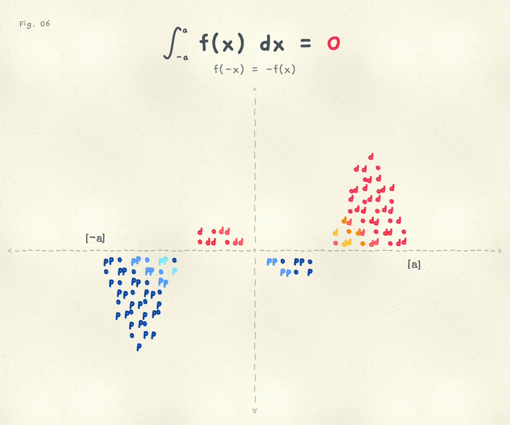

# The Odd Integral

Fig. 06 in my "math facts that live in my head" series. A quote tweet of @AnalysisFact: "The integral of an odd function over an interval (-a, a) is zero."

An ASCII graph of two jello bubbles, f(x) = 1.5 sin(πx/a), one up and one down, falling to 0 at -a and a. No outline, just the letters. The area above the axis is filled with the word "odd" in warm, shimmering marker colours. The area below is the same word turned 180°, in cool colours. Pull the curve anywhere and it wobbles like jello. The point straight through the origin moves the opposite way, so the function stays odd and the two areas always cancel. Drag `[a]` or `[-a]` to move the interval: it can cut the bubbles short of their roots, so the fills stand off the axis at the ends and it's still 0.

Open it: https://ibeez.github.io/odd-function/



[Watch one loop (MP4)](exports/odd-integral-loop.mp4): silent, 20 seconds, H.264, 1200 × 1000 at 30 fps. It opens with the interval cut short, then shows a moment with warm and cool on both sides of the origin.

## Run It Locally

```bash
python3 -m http.server 8769 --bind 127.0.0.1
```

Then open http://127.0.0.1:8769/.

Drag the curve or the handles. Double tap to reset the bubbles. Press Tab to reveal Replay, Reset, Pause and Record. Record (local only) snaps to rest and saves one 20-second seamless loop of the hands-free demo. Reduced motion turns off the demo and the shimmer.

Re-render the video with `python3 render.py` (headless Chrome renders `index.html?render` one frame at a time; OpenCV encodes H.264).

## How It Works

One canvas, plain JavaScript, no libraries. The same 16 × 25 Gaegu grid as Fig. 04, with an odd number of rows and columns so every cell has a twin through the origin. The curve is stored on nodes for u = x/a in [0, 1], ends pinned at 0, and read back with f(-x) = -f(x). Stretching a stretches the bubbles and flattens them so they keep roughly their size. Each node springs toward its target and tugs on its neighbours, which gives the jello. A pull adds an odd bump (a hill at x, a valley at -x). Fill cells below the axis copy their twin's letter, colour and wobble, rotated 180°.
